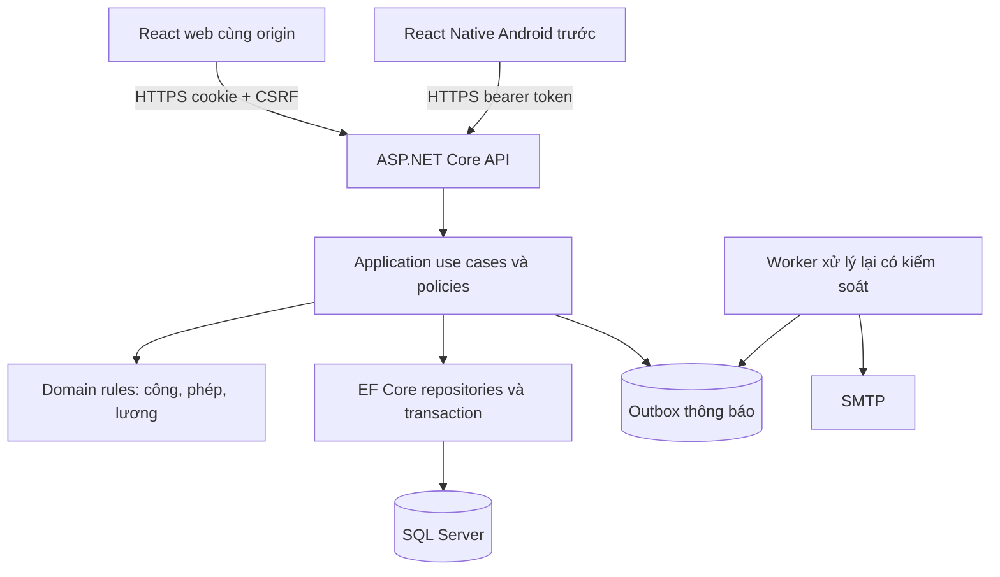

# Báo cáo định hướng HRM: đồ án 8 tuần và lộ trình sử dụng thực tế

Phiên bản 1.0 — 09/11/2026. Chủ dự án: một sinh viên kiểm duyệt; AI triển khai code. Thời hạn: khoảng 2 tháng. Mobile: React Native, đã được chủ dự án lựa chọn. Đây là kế hoạch và hợp đồng giao việc, chưa phải xác nhận hệ thống mới đã được xây dựng.

## 1. Quyết định trọng tâm

Giữ C# và SQL Server; xây backend ASP.NET Core dùng chung, web React/TypeScript cho quản trị và nhân viên, React Native/TypeScript cho nhân viên. Backend tổ chức theo modular monolith: một ứng dụng triển khai, module nghiệp vụ phân tách rõ. Chuyển dần quy tắc đã kiểm chứng từ hệ thống cũ, không sao chép nguyên trạng lỗi. Giữ nguyên WinForms làm bản tham chiếu, không duy trì hai đường ghi đồng thời vào cùng database khi chạy thử sản phẩm mới.

Mục tiêu 8 tuần: bản đồ án có đầy đủ một chuỗi nghiệp vụ xuyên web–API–mobile, kiểm thử thực sự, triển khai staging và bộ tài liệu bảo vệ. Chạy thử thực tế chỉ mở sau khi đạt cổng nghiệm thu. Không đồng nhất demo thành công với khả năng tính lương chính thức hay phát hành thương mại.

Không triển khai SaaS nhiều công ty, microservices, nhận diện khuôn mặt, GPS chống gian lận, offline chấm công, tự động hóa thuế/bảo hiểm, chatbot truy cập toàn bộ dữ liệu, tuyển dụng/đào tạo đầy đủ trong 8 tuần. Các hạng mục này được giữ trong backlog sau đồ án.

## 2. Nền tảng và giới hạn kiểm chứng

Repository cong0905/HRM, main, commit 8b1236573f99c28f4cd486831cb30635a01bd061; đã đối chiếu GitHub trong lần lập kế hoạch này và chưa thay đổi so với lần đánh giá trước. Có 5 project, 234 file theo dõi và 30 entity EF. Đã build solution thành công với cảnh báo nullability; đã sinh script migration offline, kiểm tra service bằng dữ liệu giả và quét dependency. Chưa kiểm thử giao diện, SQL Server thật, SMTP thật hoặc Gemini thật. Kết quả cũ được lưu trong thư mục evidence; không dùng nó làm bằng chứng cho code sau khi sửa.

Các phát hiện quan trọng:

| Mã | Phát hiện | Bằng chứng/mức xác minh | Xử lý |
|---|---|---|---|
| F01 | Cột Hwid không có trong script tạo DB | EF nhận 6/7 migration; script không tạo Hwid | T02 |
| F02 | Sửa lương hiện tại cập nhật lương quá khứ; GET có ghi | Đọc đường gọi NhanVienService/BangLuongService | T13, T14 |
| F03 | Xóa bảng lương trước khi tính mới, thiếu transaction toàn bộ | Đọc service và repository | T14 |
| F04 | Chưa có hiệu suất bị hệ số -10% | Kiểm tra độc lập đã trả -0.10 | T13 |
| F05 | Duyệt phép có thể âm quỹ | Dữ liệu giả: còn 1, duyệt 3, còn -2 | T11 |
| F06 | Reset nhận token VerifyEmail | Kiểm tra service với fake repository thành công | T06 |
| F07 | NullEmailSender bị coi là gửi thành công | Kiểm tra độc lập với email giả hợp lệ | T06, T22 |
| F08 | Username thiếu unique; token có shadow FK sai | Đã kiểm tra EF model | T02, T06 |
| F09 | Phân quyền ở GUI, service tin isAdmin/ID người dùng | Đọc code; chưa mô phỏng tấn công runtime | T07 |
| F10 | Form sửa bỏ DiaChi/TinhTrangHonNhan nhưng service gán null | Đọc cả form và DTO/service | T08 |
| F11 | NoTracking mặc định nhưng sửa entity rồi SaveChanges | Đọc đường tự đóng tin; kiểm tra tracking độc lập | T05; tuyển dụng sửa ở P01 |
| F12 | Giờ máy, IP cục bộ và HWID chưa bảo đảm chống gian lận | Đọc ChamCongService | T10, P02 |
| F13 | Mật khẩu ngày sinh, đổi mật khẩu thiếu kiểm tra thống nhất; nghỉ việc không khóa account | Đọc code | T06, T08 |
| F14 | System.Text.Json 8.0.0 có hai advisory High trong lần restore | Quét dependency, chưa chứng minh khai thác | T04 |

Nguồn theo file được tập hợp ở 06_DOI_CHIEU_NGUON.md. Đây là phân loại rủi ro kỹ thuật; chưa có kết luận tuân thủ pháp luật lao động/thuế.

## 3. Giá trị đồ án và câu hỏi cần chứng minh

Tên đề tài gợi ý: “Xây dựng hệ thống quản lý nhân sự đa nền tảng với quản lý chấm công, nghỉ phép và tiền lương”. Điểm kỹ thuật bảo vệ: cùng một backend cho hai nền tảng; kiểm soát quyền theo vai trò và phạm vi dữ liệu; transaction và chống ghi đồng thời khi duyệt phép; lương theo phiên bản chính sách và snapshot; kiểm thử tự động và triển khai có thể phục hồi.

Không lấy số màn hình hoặc số dòng code làm thành tích chính. Báo cáo cần chứng minh: một lần bấm gửi lại không tạo hai công; hai người duyệt không làm âm phép; đổi lương không đổi kỳ đã chốt; nhân viên không đọc phiếu lương người khác; database mới dựng được từ tài liệu. Bạn phải giải thích được những điểm này dù AI viết code.

## 4. Phạm vi phiên bản bảo vệ

| Module | Web | Mobile React Native | Backend/điều kiện |
|---|---|---|---|
| Tài khoản | Đăng nhập/đăng xuất, đổi/quên mật khẩu | Tương ứng, lưu phiên an toàn | Identity, giới hạn thử, khóa account |
| Nhân viên/phòng ban | HR quản lý hồ sơ và trạng thái; nhân viên xem của mình | Xem hồ sơ của mình | DTO riêng, dữ liệu nhạy cảm theo quyền |
| Lịch làm việc | HR cấu hình lịch công ty đơn giản | Xem lịch ngày của mình | Một múi giờ, ca ngày cố định ở MVP |
| Chấm công | HR tra cứu và điều chỉnh có lý do | Check-in/out online, xem lịch sử | Giờ server, chống lặp; chưa xác nhận địa điểm đáng tin |
| Nghỉ phép | HR duyệt/từ chối; nhân viên tạo/xem/hủy đơn chờ | Nhân viên tạo/xem/hủy đơn chờ | Cùng quy tắc quỹ phép và lịch |
| Lương | Payroll tính nháp, duyệt, chốt, xuất CSV; cá nhân xem đã công bố | Cá nhân xem phiếu đã công bố | Snapshot, công thức minh bạch, không hồi tố tự động |
| Dashboard | Số liệu theo quyền | Tóm tắt cá nhân | Từ API thật, không trộn mock |

Tuyển dụng, đào tạo, chứng chỉ, chatbot, đánh giá hiệu suất nâng cao được hoãn. Chưa có hiệu suất phải trung tính; MVP có thể tắt hoàn toàn liên kết hiệu suất–lương bằng chính sách được ghi nhận. Chỉ mở lại khi đã có bộ ví dụ được chủ dự án kiểm duyệt.

## 5. Kiến trúc đích

Cấu trúc đề xuất (chưa tồn tại): backend/src/HRM.Api, HRM.Application, HRM.Domain, HRM.Infrastructure; backend/tests; web; mobile; contracts; docs; ops. Module Identity, Personnel, Attendance, Leave, Payroll nằm trong các project này. Domain không phụ thuộc WinForms/EF/HTTP; Application chứa use case và interface; Infrastructure cài đặt EF/email; Api chỉ nhận request, xác thực và gọi use case. Không bọc mọi thao tác CRUD bằng nhiều abstraction nếu không tạo lợi ích kiểm thử.

API là nơi duy nhất được ghi DB nghiệp vụ của phiên bản mới. Không cho client truyền bool isAdmin, VaiTro hoặc MaNhanVien để quyết định quyền; server lấy người gọi từ phiên và kiểm tra phạm vi. Cùng một use case phục vụ web/mobile. Không chia sẻ công thức lương bằng việc copy sang TypeScript.

Stack đề xuất: .NET 10 LTS và EF Core tương thích; React + TypeScript + Vite; React Native với Expo nếu các module native cần thiết được hỗ trợ; SQL Server; xUnit/integration tests SQL Server; Playwright cho web. Android là nền tảng nghiệm thu mobile trong 8 tuần. iOS giữ khả năng mở rộng, nhưng chưa cam kết build/test/phát hành nếu chưa có macOS, thiết bị và tài khoản phù hợp.

.NET 8 hết hỗ trợ 10/11/2026; chọn phiên bản patch được hỗ trợ ở lúc triển khai, pin SDK/package và lockfile. Không ghi “latest” vào hợp đồng build. Nguồn: https://dotnet.microsoft.com/en-us/platform/support/policy

## 6. Xác thực, quyền và dữ liệu nhạy cảm

MVP dùng ASP.NET Core Identity cho user/password/reset/lockout. Web cùng origin dùng cookie HttpOnly, Secure, SameSite phù hợp kèm chống CSRF cho thao tác ghi. Mobile dùng bearer token được framework hỗ trợ, refresh có giới hạn và lưu bằng secure storage. Identity API bearer mặc định không được mô tả là JWT/OIDC. Không tự viết thuật toán ký token hoặc dùng lại OTP hiện tại làm phiên đăng nhập.

T06 phải kiểm chứng việc vô hiệu hóa phiên: account bị khóa, nghỉ việc hoặc đổi/reset mật khẩu không tiếp tục gọi API nhạy cảm. Nếu cơ chế mặc định không đáp ứng, bổ sung kiểm tra phiên/security stamp phía server và test cả cookie/bearer/refresh; không chỉ giảm thời hạn token rồi tuyên bố đã thu hồi ngay. Chính sách đề xuất: access 10 phút, refresh tối đa 7 ngày, không có “ghi nhớ vĩnh viễn”; chốt giá trị sau thử nghiệm. Khi cần SSO/OIDC, đánh giá OpenIddict hoặc nhà cung cấp chuyên dụng ở giai đoạn sau.

Vai trò: SystemAdmin quản lý cấu hình/tài khoản; HR quản lý nhân viên/công/phép; Payroll quản lý lương; Employee chỉ dữ liệu của mình. Admin không mặc nhiên cần xem toàn bộ lương; tài khoản demo có thể được gán nhiều vai trò có chủ đích. Quyền ApprovePayroll và PublishPayroll tách biệt; môi trường pilot yêu cầu người duyệt khác người tính, demo dùng hai tài khoản giả. Manager duyệt trong nhóm là mở rộng sau MVP.

Audit ghi ai, khi nào, tác vụ, bản ghi, trường thay đổi và lý do, che giá trị nhạy cảm khi cần; không ghi mật khẩu/token. Xuất CSV là một quyền riêng, chống công thức bảng tính từ dữ liệu người dùng. Lương và CCCD không xuất hiện trong push/log công khai. Gemini không nằm ở MVP.

Nguồn Identity: https://learn.microsoft.com/en-gb/aspnet/core/security/authentication/identity-api-authorization?view=aspnetcore-10.0
Nguồn mobile: https://reactnative.dev/docs/security — AsyncStorage không dùng để giữ token/bí mật.

## 7. Chuyển đổi dữ liệu và bảo toàn đầu tư cũ

Giữ db/src hiện tại làm legacy, không đổi tên/xóa hàng loạt. Sửa lỗi nền tảng có kiểm thử hồi quy; chuyển từng use case sang backend mới. Dữ liệu demo mới không dùng thông tin cá nhân thật. Backend dùng DB riêng HRM_Next_Dev/Test/Staging; không vô tình trỏ fallback tới HRM_System đang có dữ liệu.

Nếu có dữ liệu thật: sao lưu và thử phục hồi trước; lập mapping ID/tài khoản/nhân viên; báo trùng username/email, mồ côi FK, quỹ phép âm, công trùng; không tự xóa/gộp dữ liệu xung đột. Import dry-run có thống kê và báo cáo đối soát; cutover trong cửa sổ dừng ghi, chỉ một hệ thống ghi. Giữ mã nhân viên và mapping legacy ID; kiểm tổng dòng, tổng lương theo kỳ và tài khoản đang hoạt động.

Không coi hash BCrypt cũ là hash Identity tương thích. Với MVP không có người dùng thật: tạo account demo bằng Identity. Với dữ liệu thật: chọn bắt buộc reset an toàn hoặc bộ xác minh BCrypt tạm có rehash sau login và thời hạn gỡ bỏ; phải kiểm thử, không sao chép mật khẩu mặc định. Tính lương cũ không tự tính lại khi import; giữ snapshot lịch sử đã trả.

Rollback code không đồng nghĩa rollback dữ liệu. Migration ưu tiên thêm cấu trúc tương thích; chuyển dữ liệu và xóa cột ở các phiên bản riêng. Backup phục hồi được và ghi chép điểm dừng ghi là điều kiện cutover.

## 8. Tiến độ 8 tuần

Đây là kế hoạch có điều kiện, không phải cam kết AI tự hoàn thành đúng hạn. Tạm giả định bạn dành tối thiểu 20–25 giờ/tuần cho kiểm duyệt, chạy demo, học luồng và viết báo cáo; AI làm việc trong các phiên có kiểm tra. Nếu ít thời gian hơn phải cắt phạm vi, không cắt bảo mật và tính toàn vẹn dữ liệu.

| Tuần | Nhiệm vụ | Kết quả phải xem được |
|---|---|---|
| 1 | T00–T04 | Scope chốt, fixture và CI, migration/dependency đã xử lý |
| 2 | T05–T08 | API + Identity + quyền + nhân viên; kiểm chứng phiên cookie/bearer bằng API client |
| 3 | T09–T12, bắt đầu T16 | Công/phép đúng quy tắc, kiểm thử đồng thời; khung web |
| 4 | T13–T15, T17 | Tính/chốt lương và nhân sự trên web; dữ liệu không hồi tố |
| 5 | T18–T20 | Web xuyên suốt, khung mobile và phiên an toàn |
| 6 | T21–T23 | Mobile nghiệp vụ thật, email staging, rehearsal chuyển dữ liệu demo |
| 7 | T24–T26 | E2E, staging, thử backup/restore, sửa lỗi chặn |
| 8 | T27–T28 | Đóng tính năng, UAT, báo cáo/slides/video và diễn tập bảo vệ |

Không dồn viết báo cáo vào tuần 8: cập nhật sơ đồ, ảnh và kết quả mỗi tuần. Cuối tuần 2 nếu auth/API chưa ổn: dừng mở rộng UI. Cuối tuần 4 nếu lương/công/phép chưa đúng: giữ mobile chỉ hồ sơ và nghỉ phép trước, thêm công/lương sau khi API ổn. Cuối tuần 6 đóng scope mới. Tuần 8 chỉ sửa lỗi và bảo vệ.

## 9. Cổng chất lượng

G0 Baseline: repo sạch có mốc, fixture giả, DB test riêng, báo cáo lỗi có tái hiện. G1 Nền tảng: build+CI, DB tạo mới/nâng cấp, auth/permission tests đạt. G2 Nghiệp vụ: cùng test fixtures cho ngày công/phép/lương; rollback và đồng thời đạt. G3 Đa nền tảng: web và Android dùng API staging, không dựa mock để chứng minh hoàn thành. G4 Bảo vệ: kịch bản 10 phút, dữ liệu giả, tài liệu khớp code, người kiểm duyệt giải thích được các invariant. G5 Pilot: bảo mật, data mapping, backup restore, người chịu trách nhiệm nghiệp vụ và hỗ trợ đã sẵn sàng.

Không dùng một tỷ lệ coverage đơn lẻ làm cổng. Bắt buộc test các quy tắc tiền, quyền và trạng thái; báo cáo phạm vi chưa test. Test giả/in-memory không thay SQL Server integration cho constraint và transaction. Không tự động đánh dấu hoàn thành từ build xanh.

## 10. Sau đồ án: đường ra người dùng thật

Pilot một đơn vị có đầu mối HR, dữ liệu giới hạn, 2–4 tuần quan sát đề xuất. Một deployment cho một công ty; chưa hứa SaaS nhiều công ty. Ban đầu chạy đối soát lương song song, không dùng kết quả hệ thống làm nguồn chi trả duy nhất. Chốt chính sách với người chịu trách nhiệm HR/kế toán; thuế/bảo hiểm và quyền xử lý dữ liệu cần rà soát theo quy định tại thời điểm triển khai, tài liệu này không cung cấp công thức pháp lý.

Điều kiện trước pilot: toàn bộ lỗi nghiêm trọng đóng; tài khoản thật riêng, bắt buộc đổi mật khẩu/MFA cho quyền cao nếu khả thi; TLS; không seed admin mặc định; backup ngoài máy chạy đã phục hồi thử; log/alert; kế hoạch quay lại hệ thống cũ; hỗ trợ sự cố; xác nhận phạm vi dữ liệu và lưu trữ. Trước phát hành rộng: kiểm thử bảo mật độc lập, tải thực tế, quản lý phiên bản mobile, chính sách quyền riêng tư/xóa dữ liệu, kế hoạch vận hành và ngân sách được duyệt.

Mục tiêu thử tải đề xuất, chưa được chứng minh: fixture 500 nhân viên, 12 tháng công; 30 phiên đồng thời; p95 API đọc phổ biến dưới 1 giây và error rate dưới 1% trên cấu hình staging ghi rõ. Báo cáo phần auth/lương riêng; tác vụ tính tháng có trạng thái tiến độ. RPO 24 giờ/RTO 4 giờ chỉ là mục tiêu pilot để chủ đơn vị chấp nhận; đo bằng restore drill trước khi công bố.

Chi phí cần lập dự toán ở T25: máy API, SQL Server/license phù hợp, lưu backup, domain/TLS, SMTP, giám sát, Android distribution; iOS có yêu cầu riêng. Không lấy SQL Server Developer làm bản quyền production. Không tự mua dịch vụ hoặc công bố ứng dụng khi chưa được yêu cầu.

## 11. Cách một người kiểm duyệt AI

Một task đang triển khai tại một thời điểm là mặc định. Mỗi task có phạm vi file, phụ thuộc, tiêu chí chấp nhận và test. AI phải báo diff, migration, kết quả thật và điểm chưa xác minh. Bạn kiểm tra hành vi qua kịch bản, không chỉ đọc lời giải thích. Nhiệm vụ nhạy cảm về tiền/quyền cần một lượt review tách khỏi lượt viết code trước khi merge.

Mỗi ngày dành thời gian xem diff, chạy 1–2 tình huống âm và cập nhật decision log. Mỗi tuần diễn tập 5–10 phút giải thích luồng. Tuân thủ quy định sử dụng AI và trích dẫn của trường; ghi lại phần AI hỗ trợ và phần bạn thiết kế/kiểm chứng. Không bịa tác giả, số liệu kiểm thử hoặc kết quả triển khai trong báo cáo.

## 12. Thứ tự bắt đầu

Đọc 02_DAC_TA_MVP.md; duyệt T00; giao AI T01; sau đó T02 và T03. Không giao cả backlog một lần. Dùng prompt trong 04_PROMPT_GIAO_AI.md và từng file tasks/Txx.md. Báo cáo này không cấp quyền tự động triển khai production hoặc tự ý thay đổi dữ liệu thật.
