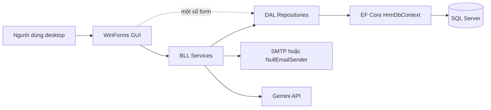

# Hiện trạng repository và cách chuyển sang đa nền tảng

Phạm vi: source/docs/config/migrations tại commit8b1236573f99c28f4cd486831cb30635a01bd061. Đã điều hướng bằng Graphify và đọc source; kết quả build/kiểm tra offline có trong evidence. Đây là đánh giá tổng thể các lớp và luồng quan trọng, không phải cam kết kiểm thử mọi nhánh của187 file C#.

## 1. Cấu trúc và trách nhiệm hiện tại

| Thành phần | Bằng chứng | Trách nhiệm quan sát được | Đánh giá |
|---|---|---|---|
| HRM.GUI | [db/src/HRM.GUI/HRM.GUI.csproj](https://github.com/cong0905/HRM/blob/8b1236573f99c28f4cd486831cb30635a01bd061/db/src/HRM.GUI/HRM.GUI.csproj) | WinForms .NET8 Windows; form/login/menu, DI, cấu hình và khởi động migration | Không có frontend web/mobile hiện tại; GUI tham chiếu cả BLL/DAL/Common |
| HRM.BLL | [db/src/HRM.BLL/HRM.BLL.csproj](https://github.com/cong0905/HRM/blob/8b1236573f99c28f4cd486831cb30635a01bd061/db/src/HRM.BLL/HRM.BLL.csproj) | Service nhân sự, công, phép, lương, hiệu suất, tuyển dụng, auth, Gemini | Có logic có thể chuyển, nhưng cần tách policy và transaction |
| HRM.DAL | [db/src/HRM.DAL/Context/HrmDbContext.cs](https://github.com/cong0905/HRM/blob/8b1236573f99c28f4cd486831cb30635a01bd061/db/src/HRM.DAL/Context/HrmDbContext.cs) | EF Core SQL Server, repository, model configs, migrations |30 entity; migration/constraint/tracking cần sửa trước nâng cấp |
| HRM.Domain | [db/src/HRM.Domain/HRM.Domain.csproj](https://github.com/cong0905/HRM/blob/8b1236573f99c28f4cd486831cb30635a01bd061/db/src/HRM.Domain/HRM.Domain.csproj) | Entity dữ liệu nghiệp vụ | Chưa tương đương domain model đầy đủ với invariant được bảo vệ |
| HRM.Common | [db/src/HRM.Common/HRM.Common.csproj](https://github.com/cong0905/HRM/blob/8b1236573f99c28f4cd486831cb30635a01bd061/db/src/HRM.Common/HRM.Common.csproj) | DTO, password policy/hash, email helpers | Có thể giữ DTO ý nghĩa, nhưng tránh kéo logic xác thực desktop sang API |
| Tài liệu DB/setup | [db/HuongDanChayDuAn.md](https://github.com/cong0905/HRM/blob/8b1236573f99c28f4cd486831cb30635a01bd061/db/HuongDanChayDuAn.md), [db/docs/HRM_Database.sql](https://github.com/cong0905/HRM/blob/8b1236573f99c28f4cd486831cb30635a01bd061/db/docs/HRM_Database.sql) | Hướng dẫn chạy, SQL mẫu | Cần đồng bộ nguồn schema và lệnh dựng DB |

Đây là ứng dụng desktop truy cập DB qua thư viện trong cùng tiến trình, chưa phải API server. Thêm React/RN không thể chỉ “đổi giao diện”: phải đưa quyền, session, validation và transaction vào backend để client không giữ credential DB hay được tin tự quyết role.

## 2. Luồng xác thực và credential hiện tại

Form login gọi AuthService.LoginAsync → TaiKhoanRepository lọc username + trạng thái Hoạt động, include nhân viên/phòng ban → PasswordHelper kiểm BCrypt → cập nhật lần đăng nhập → trả UserSessionDTO chứa account/employee/role/name. GUI dùng DTO để điều khiển menu. Không có access JWT/refresh token cho request web/mobile trong luồng này. Nguồn: [db/src/HRM.BLL/Services/AuthService.cs](https://github.com/cong0905/HRM/blob/8b1236573f99c28f4cd486831cb30635a01bd061/db/src/HRM.BLL/Services/AuthService.cs), [db/src/HRM.DAL/Repositories/TaiKhoanRepository.cs](https://github.com/cong0905/HRM/blob/8b1236573f99c28f4cd486831cb30635a01bd061/db/src/HRM.DAL/Repositories/TaiKhoanRepository.cs), [db/src/HRM.Common/Helpers/PasswordHelper.cs](https://github.com/cong0905/HRM/blob/8b1236573f99c28f4cd486831cb30635a01bd061/db/src/HRM.Common/Helpers/PasswordHelper.cs).

Reset tạo mã6 chữ số bằng Random.Shared, lưu Token thô + Purpose + expiry; repository tìm theo token chưa dùng/chưa hết hạn. Reset service thiếu Purpose check; đổi hash và đánh used bằng hai lần lưu. Email URL placeholder và thời hạn mô tả khác expiry. Sender no-op làm UI hiểu nhầm đã gửi. Đây là lý do T06 thay lifecycle bằng Identity và test revoke/one-use, không vá mỗi regex mật khẩu.

Credential SQL/SMTP/Gemini đi qua cấu hình phía desktop; file cấu hình được copy ra output theo project. Không khẳng định key hiện hành đã bị lộ hoặc còn hiệu lực; vấn đề kiến trúc là client người dùng không nên giữ secret dịch vụ chung khi phát hành. Backend mới giữ secret ở server, app chỉ giữ phiên của người dùng theo cơ chế phù hợp.

## 3. Luồng nghiệp vụ và mức hoàn thiện

| Luồng | Đã thấy trong code | Điểm cần hoàn thiện trước kế thừa |
|---|---|---|
| Nhân viên | Tạo/sửa/trạng thái; liên kết phòng ban/chức vụ; tạo account | DOB password, lỗi account bị nuốt, partial DTO làm mất dữ liệu, nghỉ việc chưa vô hiệu account |
| Chấm công | Check-in/out, giờ/IP/HWID và tra cứu | Server time, missing checkout, duplicate/concurrency, calendar và khóa kỳ |
| Nghỉ phép | Tạo đơn, quỹ phép, duyệt/từ chối | Calendar days khác ngày làm; quỹ cần recheck lúc duyệt, transaction/idempotency |
| Bảng lương | Tính tháng, công, phụ cấp/thưởng, đồng bộ lương và hiệu suất | Không ghi trên GET, không thay lịch sử, snapshot và run/version, công thức fixture rõ |
| Hiệu suất | Nhập và tính chỉ số/bonus, lịch ngày làm | Null bị phạt; delete cần khóa giống update; cần chuyên gia HR xác nhận nếu gắn với lương |
| Tuyển dụng | Tin, ứng viên, phỏng vấn, chuyển nhân viên | Tracking/status bất nhất, auto hire theo vòng, convert ở GUI và thiếu giao dịch |
| Đào tạo/chứng chỉ/chính sách | Có entity/DbSet và cấu trúc dữ liệu | Sự tồn tại bảng chưa chứng minh có use case UI/service đầu cuối; không quảng cáo là module hoàn chỉnh |
| Chatbot | Ghép ngữ cảnh nhân viên và gọi Gemini | API key/truyền dữ liệu cá nhân, lỗi dịch vụ, phạm vi dữ liệu; tách khỏi MVP |

Giá trị kế thừa lớn nhất là mô hình thuật ngữ, entity, UI làm tham khảo yêu cầu và một phần tính toán đã hiểu. Phần cần thay là trust boundary, auth, giao dịch, lương lịch sử và cách vận hành. Giữ C#/SQL giảm số công nghệ phải học; React và RN cùng TypeScript giúp chia sẻ contract/type, không hứa chia sẻ toàn bộ giao diện.

## 4. Database

HrmDbContext khai báo30 entity: nhóm nhân viên/tài liệu/điều chuyển; công/điều chỉnh; loại phụ cấp/phụ cấp/thưởng phạt/bảng lương; loại phép/quỹ/đơn; kỳ đánh giá/hiệu suất; đào tạo/phân công/đánh giá/chứng chỉ; phòng ban/chức vụ; tin/ứng viên/phỏng vấn/quyết định; chính sách/lịch sử/xác nhận; tài khoản/thông báo/reset token.

Quan hệ trung tâm là NhanVien với TaiKhoan, phòng ban/chức vụ, công/phép/lương/hiệu suất. Tuyển dụng có lifecycle trước khi trở thành nhân viên. Chính sách/đào tạo là module mở rộng; không nên chuyển mọi bảng thành màn CRUD chỉ để đủ số lượng. Xem model/context/config để xác nhận cardinality cụ thể, đặc biệt FK reset token đang khác ý định.

Ưu tiên dữ liệu: sửa fresh/upgrade migration; unique username chuẩn hóa; employee code theo policy; FK rõ; index theo employee+date/period; rowversion/concurrency; salary effective history; immutable payroll snapshot; audit/outbox. Chỉ thêm index sau đối chiếu query plan/tải; index không thay transaction. Không tự xóa dữ liệu trùng để migration “chạy được”.

## 5. Chất lượng code và khả năng kiểm thử

Điểm có thể tận dụng: chia project theo trách nhiệm, interface service/repository, EF model configs và DTO, password hashing qua helper, có validation ở một số đường. Tuy nhiên boundary chưa nhất quán: GUI gọi repository, service biết dữ liệu cần scope nhưng chưa kiểm quyền hệ thống, root service locator, scoped context chưa có scope theo thao tác, mặc định NoTracking mâu thuẫn mutation, repository tự SaveChanges làm use case khó atomic.

Lỗi tiền không giải quyết bằng chỉ tách method cho ngắn. Cần pure calculator có fixture, use case transaction, state machine và snapshot. Lỗi quyền cần deny-by-default ở server và negative tests. Cảnh báo nullable cần xử lý chỗ liên quan thay đổi; không dùng dấu ! hàng loạt để làm build im.

Hiện không thấy test project/workflow kiểm thử sản phẩm trong tracked files. Audit bên ngoài đã chứng minh một số lỗi bằng fake repository/EF model offline, nhưng chưa test SQL concurrency, UI, email hay thiết bị. T01 đưa regression vào repo; T12/T24 cần SQL thật test; T20/T21 cần Android evidence.

## 6. Deployment và vận hành

Hiện là WinForms cấu hình SQL rồi tự migration lúc startup, chưa có deployment web/API/mobile để tái sử dụng nguyên trạng. Cần build có version, backend/web cùng origin HTTPS, mobile endpoint theo môi trường, secret ngoài source, DB không public, migration bước riêng, health/log/trace, backup restore và rollback rõ. SQL Server production cần quyền sử dụng đúng edition; bản Developer chỉ để phát triển/test.

Không đổi sang microservices chỉ để đề tài nghe lớn. Một API modular monolith + SQL + worker outbox đủ rõ để bảo vệ kiến trúc và dễ vận hành bởi một người. Sau số liệu pilot mới đánh giá tách service, cache phân tán hay nhiều tenant.

## 7. Thứ tự tác động/công sức

| Nhóm | Tác động | Công sức tương đối | Lý do xếp trước/sau |
|---|---|---|---|
| Migration/data integrity/auth/permission | Rất cao | Vừa–lớn | Mọi UI phụ thuộc nền tảng; không được đưa lỗi này ra người thật |
| Calendar/transaction/lương snapshot | Rất cao | Lớn | Giá trị nghiệp vụ và điểm bảo vệ; sai tiền khó khắc phục |
| Web quản trị và mobile nhân viên | Cao | Lớn | Thể hiện đa nền tảng, chỉ nối khi API contract ổn |
| Test/CI/staging/restore | Rất cao | Vừa–lớn | Cung cấp bằng chứng đúng và khả năng chạy lại |
| Dashboard/export trang trí | Trung bình | Nhỏ–vừa | Giảm nếu trễ, không thay core correctness |
| Tuyển dụng/đào tạo/AI/SSO/SaaS | Phụ thuộc nhu cầu | Lớn–rất lớn | Ngoài8 tuần; cần khảo sát và backlog riêng |

Chi tiết22 phát hiện có link dòng ở [06_DOI_CHIEU_NGUON.md](06_DOI_CHIEU_NGUON.md); nhiệm vụ có dependencies/acceptance ở [03_BACKLOG.md](03_BACKLOG.md).
