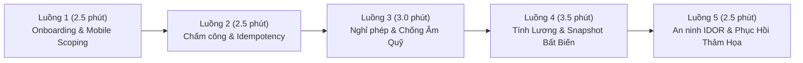

# Kịch Bản Trình Diễn Bảo Vệ Đồ Án (5 Core Demo Scenarios)

Tài liệu này hướng dẫn chi tiết quy trình thực hiện **5 luồng demo trực tiếp (Live Demo Workflows)** trước Hội đồng chấm đồ án tốt nghiệp, dựa trên cấu hình môi trường chuẩn tại [demo-reset-guide.md](file:///d:/dotnet%20project/docs/demo/demo-reset-guide.md) và các yêu cầu nghiệm thu trong [05_LO_TRINH_NGHIEM_THU.md](file:///d:/dotnet%20project/HRM_KeHoach_DoAn_8Tuan/05_LO_TRINH_NGHIEM_THU.md).

---

## Tóm Tắt 5 Luồng Demo & Phân Bổ Thời Gian (Tổng: 12–15 phút)



---

## Luồng 1: Tuyển Dụng Nhân Viên Mới, Kích Hoạt & Đăng Nhập Phân Quyền Mobile (2.5 phút)

### Mục tiêu chứng minh
- HR tạo hồ sơ nhân viên và tài khoản người dùng nguyên tử.
- Transactional Outbox gửi email kích hoạt qua MailHog (không lộ token trong log).
- Nhân viên tự kích hoạt tài khoản và đăng nhập trên Android Mobile App.
- Cơ chế **Record Scoping**: Nhân viên trên Mobile chỉ xem được hồ sơ của chính mình qua route `/me`, triệt tiêu hoàn toàn lỗ hổng IDOR.

### Các bước thao tác
1. **Đăng nhập Web Quản trị**:
   - Truy cập `https://localhost` bằng tài khoản HR Manager: `hr_manager` / `[mật khẩu demo cấp riêng]`.
2. **Thêm mới nhân viên**:
   - Điều hướng tới **Nhân sự** -> Bấm **Thêm nhân viên**.
   - Điền thông tin:
     - Họ và tên: `Đặng Hoàng Giang`
     - Mã nhân viên: `NV0099`
     - Email công việc: `giang.dang@hrm-company.local`
     - Phòng ban: `Phòng Kỹ thuật` (Engineering)
     - Mức lương cơ bản: `22,000,000 VND`
   - Bấm **Lưu & Gửi lời mời**.
3. **Kiểm tra Transactional Outbox trên MailHog**:
   - Mở tab trình duyệt mới tới `http://localhost:8025`.
   - Quan sát email mới nhận: Tiêu đề `"Kích hoạt tài khoản HRM - Đặng Hoàng Giang"`.
   - Mở email và bấm vào liên kết kích hoạt, nhập mật khẩu mới: `Giang@Pass123`.
4. **Đăng nhập trên Mobile App (Android Emulator)**:
   - Mở ứng dụng di động, đăng nhập bằng `giang.dang@hrm-company.local` / `Giang@Pass123`.
   - Màn hình **Hồ sơ cá nhân** xuất hiện với đúng thông tin của Đặng Hoàng Giang.
   - **Điểm nhấn bảo vệ**: Chỉ ra rằng app gọi `GET /api/v1/employees/me`, không truyền `employeeId` từ client, máy chủ tự trích xuất danh tính từ token JWT.

---

## Luồng 2: Chấm Công, Chống Trùng Lặp Idempotency & Giờ Server Chuẩn (2.5 phút)

### Mục tiêu chứng minh
- Mốc giờ chấm công hoàn toàn do Máy chủ (Server UtcNow) quyết định, loại bỏ gian lận chỉnh giờ trên điện thoại.
- Thử nghiệm gửi lại yêu cầu (Replay / Timeout retry) cùng `Idempotency-Key`: Hệ thống chỉ ghi nhận duy nhất một sự kiện chấm công.

### Các bước thao tác
1. **Thực hiện Check-in trên Mobile**:
   - Trên Mobile App của nhân viên `employee_01` (`Nguyễn Văn An`), bấm nút **Check-in**.
   - Màn hình hiển thị: `"Check-in thành công lúc 08:30:15 (Giờ máy chủ)"`.
2. **Kiểm tra hiển thị phía Web Dashboard**:
   - Trên Web Portal của HR (`hr_manager`), mở tab **Bảng chấm công hôm nay**.
   - Quan sát dòng của `Nguyễn Văn An` chuyển trạng thái sang **Đã vào làm** với thời gian tương ứng.
3. **Mô phỏng Mạng Timeout & Thử Gửi Lại (Idempotency Test)**:
   - Bật DevTools (F12) hoặc dùng script curl gửi lại chính xác payload check-in vừa gửi mang cùng `Idempotency-Key`:
     ```bash
     curl -k -X POST https://localhost/api/v1/attendance/me/check-in \
       -H "Authorization: Bearer <TOKEN>" \
       -H "Idempotency-Key: IDEM-ATT-20261119-001" \
       -H "Content-Type: application/json"
     ```
   - **Kết quả trả về**: Mã `200 OK` kèm kết quả của bản ghi cũ.
   - Kiểm tra trực tiếp trong cơ sở dữ liệu:
     ```sql
     SELECT COUNT(*) FROM AttendanceEvents WHERE EmployeeId = '<Id_NguyenVanAn>' AND CAST(TimestampUtc AS DATE) = CAST(GETUTCDATE() AS DATE);
     ```
   - **Kết quả**: Chỉ có đúng **1 bản ghi**, chỉ mục duy nhất `IX_AttendanceEvents_IdempotencyKey` bảo vệ dữ liệu tuyệt đối.

---

## Luồng 3: Nộp Đơn Phép, Phê Duyệt & Khóa Concurrency Chống Âm Quỹ (3.0 phút)

### Mục tiêu chứng minh
- Nhân viên nộp đơn nghỉ phép hợp lệ.
- Kịch bản thử thách gay cấn: **Hai quản trị viên đồng thời phê duyệt 2 đơn phép khác nhau** của cùng một nhân viên khi tổng số ngày xin vượt quá số dư còn lại.
- Chứng minh hệ thống không bao giờ bị âm quỹ phép nhờ `UPDLOCK, ROWLOCK` và `CHECK (RemainingDays >= 0)`.

### Các bước thao tác
1. **Nhân viên nộp 2 đơn nghỉ phép**:
   - Tài khoản `employee_02` (`Lê Thị Bích`) hiện còn **1.5 ngày phép**.
   - Nhân viên nộp Đơn A: Xin nghỉ 1.0 ngày (ngày 25/11).
   - Nhân viên nộp Đơn B: Xin nghỉ 1.0 ngày (ngày 26/11). (Tổng 2.0 ngày > 1.5 ngày tồn).
2. **Mô phỏng Hai Trình Duyệt Duyệt Đồng Thời (Concurrency Race)**:
   - Mở 2 cửa sổ trình duyệt độc lập (Trình duyệt Chrome và Edge/Incognito), cả hai đều đăng nhập bằng tài khoản HR.
   - Cửa sổ 1 mở Đơn A.
   - Cửa sổ 2 mở Đơn B.
   - Bấm **Phê duyệt** trên cả hai cửa sổ cùng một tích tắc.
3. **Quan sát kết quả**:
   - **Cửa sổ 1**: Phê duyệt thành công (`200 OK`). Số ngày phép còn lại giảm từ `1.5` xuống `0.5`.
   - **Cửa sổ 2**: Hệ thống trả về lỗi từ chối ngay lập tức:
     `400 Bad Request` hoặc `409 Conflict`: `"Số dư ngày phép của nhân viên không đủ để phê duyệt (Yêu cầu: 1.0, Còn lại: 0.5)"`.
   - **Đối soát Sổ cái**: Mở bảng `LeaveBalanceLedgers`: Chỉ ghi nhận đúng 1 dòng khấu trừ của Đơn A. Quỹ phép của nhân viên dừng ở mức `0.5`, **tuyệt đối không bị âm**.

---

## Luồng 4: Tính Toán Lương Nháp, Phân Tách Quyền & Snapshot Bất Biến (3.5 phút)

### Mục tiêu chứng minh
- Tính toán lương hàng loạt cho 500 nhân sự trong **0.10 giây** (tốc độ cao).
- Nguyên tắc phân tách quyền lực (**Two-Person Rule**): Chuyên viên tính bảng lương không được tự phê duyệt bảng lương.
- Tính **Bất biến của Kỳ lương đã Khóa (Locked Period Immutability)**: Mức lương hoặc bảng công thay đổi sau này không làm thay đổi phiếu lương quá khứ.

### Các bước thao tác
1. **Khởi tạo và Tính lương nháp**:
   - Đăng nhập bằng Chuyên viên tính lương: `payroll_specialist` / `[mật khẩu demo cấp riêng]`.
   - Điều hướng tới **Quản lý Tiền lương** -> Chọn **Kỳ lương Tháng 10/2026** (Trạng thái `Draft`).
   - Bấm **Tính toán bảng lương**.
   - Hệ thống quét 500 nhân sự, tính công, tính bảo hiểm, khấu trừ và sinh 500 bản ghi `PayrollCalculationSnapshot` trong **0.10 giây**.
2. **Thử vi phạm Phân tách Quyền lực (Self-Approval Test)**:
   - Trên cùng giao diện của `payroll_specialist`, bấm nút **Phê duyệt bảng lương**.
   - **Kết quả**: Bị chặn với mã lỗi `403 Forbidden`: `"Chuyên viên lập bảng lương không được tự phê duyệt bảng lương do chính mình tạo."`
3. **Phê duyệt chuẩn bởi Trưởng phòng Nhân sự**:
   - Chuyển sang trình duyệt đăng nhập bởi `hr_manager`.
   - Mở kỳ lương Tháng 10/2026, kiểm tra tổng tiền Gross/Net và bấm **Phê duyệt & Công bố**.
   - Kỳ lương chuyển trạng thái sang **Locked** (`IsLocked = true`).
4. **Kiểm tra Phiếu lương trên Mobile App**:
   - Trên Mobile App của `employee_01`, mở mục **Phiếu lương**.
   - Phiếu lương Tháng 10/2026 hiển thị chi tiết: Lương cơ bản `20,000,000 VND`, Lương thực nhận: `18,500,000 VND`.
5. **Thử thay đổi lương tương lai & Chứng minh Tính Bất biến**:
   - Quay lại Web của HR, mở hồ sơ `employee_01`, tăng lương cơ bản từ `20,000,000` lên `25,000,000 VND` có hiệu lực từ `01/11/2026`.
   - Quay lại Mobile App, mở lại phiếu lương Tháng 10/2026: **Mức lương cơ bản vẫn là 20,000,000 VND, Lương thực nhận 18,500,000 VND không hề suy suyển!**
   - **Giải thích hội đồng**: Dữ liệu đọc từ `PayrollCalculationSnapshot` bất biến, không đọc nối tiếp động từ `SalaryHistories`.

---

## Luồng 5: An Ninh IDOR, Thu Hồi Phiên Khẩn Cấp & Bằng Chứng Khôi Phục Thảm Họa (2.5 phút)

### Mục tiêu chứng minh
- Ngăn chặn triệt để tấn công đổi ID (IDOR) để xem lén hồ sơ hoặc phiếu lương của đồng nghiệp.
- Khi tài khoản bị khóa, phiên làm việc trên Mobile bị thu hồi tức thời trong **$\le 0.05$ giây** qua `SecurityStamp`.
- Trình chiếu bằng chứng kiểm thử tự động 549/549 tests PASS và năng lực phục hồi thảm họa cơ sở dữ liệu trong **0.96 giây**.

### Các bước thao tác
1. **Kiểm tra Chặn Lỗi IDOR**:
   - Nhân viên `employee_01` thử sửa URL trên trình duyệt hoặc request Postman để lấy phiếu lương của `employee_02`:
     ```http
     GET /api/v1/payroll/employees/{Id_Employee_02}/payslips/latest
     ```
   - **Kết quả**: Trả về `403 Forbidden` / `404 Not Found`. API từ chối truy cập vì người dùng không có quyền quản lý và ID không trùng với Token chủ quyền.
2. **Khóa Tài Khoản & Thu Hồi Phiên Tức Thời**:
   - Quản trị viên `admin` mở danh sách người dùng, chọn `employee_01` và bấm **Khóa tài khoản khẩn cấp (Revoke Sessions)**.
   - CSDL cập nhật `SecurityStamp = NEWID()` và `IsActive = false`.
   - Ngay lập tức trên Mobile App của `employee_01`, bấm thử nút Check-in hoặc xem hồ sơ:
     - Ứng dụng lập tức văng ra màn hình Đăng nhập với thông báo: `"Phiên đăng nhập đã bị thu hồi"`.
     - Bộ nhớ RAM và SecureStore của Mobile bị xóa sạch trong nháy mắt.
3. **Trình Chiếu Bằng Chứng Nghiệm Thu Hội Đồng (Defense Evidence)**:
   - Mở tài liệu [T24-e2e-security-report.md](file:///d:/dotnet%20project/docs/verification/T24-e2e-security-report.md): Trình bày kết quả **549/549 Tests Pass 100%**.
   - Mở tài liệu [T23-rehearsal-evidence.md](file:///d:/dotnet%20project/docs/verification/T23-rehearsal-evidence.md): Trình bày kết quả di chuyển 1,000 bản ghi legacy với dung sai tài chính đúng 0.00 VND.
   - Mở terminal chạy lệnh phục hồi nhanh:
     ```powershell
     python ops/backup/restore.py --server localhost --backup-file "ops/backup/snapshots/HRM_Next_Benchmark_20261119_151004Z.bak" --restored-db HRM_Next_Staging
     ```
     Chứng minh CSDL được phục hồi toàn vẹn trong **0.96 giây**, sẵn sàng cho phiên kiểm thử tiếp theo.

---

## Liên Kết Tài Liệu Liên Quan

- [Hướng dẫn Reset Môi trường Demo](file:///d:/dotnet%20project/docs/demo/demo-reset-guide.md)
- [10 Câu hỏi Phản biện Bảo vệ](file:///d:/dotnet%20project/docs/demo/qna-defense.md)
- [Báo cáo Kiểm chứng Toàn diện T24](file:///d:/dotnet%20project/docs/verification/T24-e2e-security-report.md)
