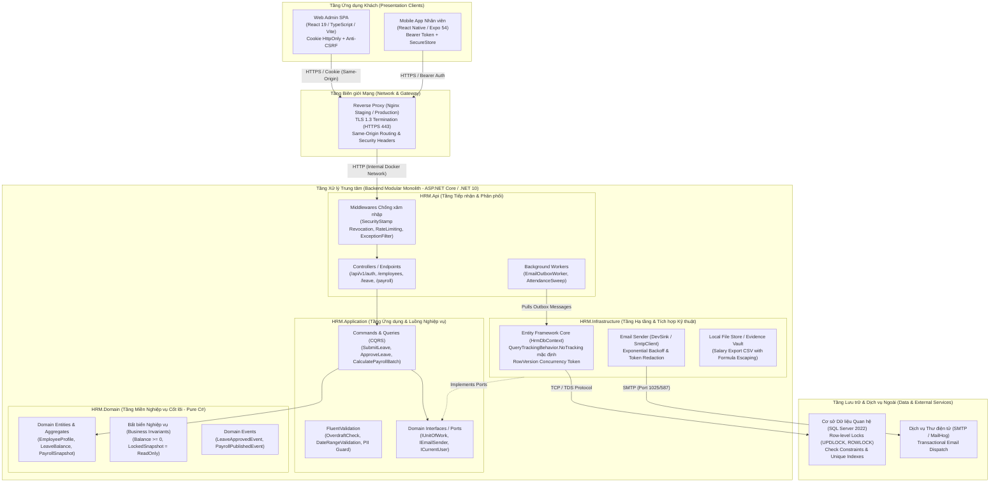
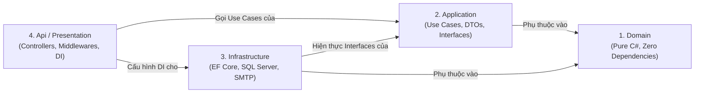
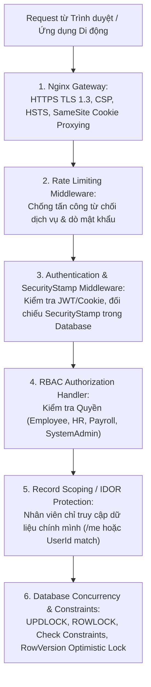

# Sơ đồ Kiến trúc Tổng thể Hệ thống HRM (Architecture Overview)

Tài liệu này mô tả kiến trúc tổng thể của hệ thống **HRM (Human Resource Management)** theo mô hình **Modular Monolith** kết hợp **Clean Architecture (Hexagonal Architecture)**. Hệ thống phân tách rõ ràng giữa các tầng trách nhiệm, bảo đảm tính bất biến của dữ liệu tài chính, an ninh phòng vệ chiều sâu (Defense-in-Depth) và khả năng kiểm thử độc lập.

---

## 1. Sơ đồ Kiến trúc Khối (High-Level Block Diagram)

---

## 2. Mô tả Trách nhiệm 4 Tầng Clean Architecture

Hệ thống tuân thủ nghiêm ngặt nguyên lý **Dependency Inversion Principle (DIP)**: Tầng bên trong không bao giờ phụ thuộc trực tiếp vào tầng bên ngoài.

### 2.1. HRM.Domain (Tầng Miền Nghiệp vụ Cốt lõi)
- **Đặc điểm**: Mã nguồn C# thuần túy (.NET 10), tuyệt đối không phụ thuộc vào ASP.NET Core, EF Core, UI hay bất kỳ thư viện ngoài nào.
- **Trách nhiệm**:
  - Định nghĩa thực thể (Entities), tập hợp thực thể (Aggregates) và giá trị đối tượng (Value Objects).
  - Đảm bảo các **bất biến nghiệp vụ cốt lõi (Business Invariants)**:
    - `LeaveBalance`: Quỹ phép không được âm (`AvailableDays >= 0`).
    - `PayrollCalculationSnapshot`: Bất biến sau khi phê duyệt và khóa kỳ (`Status == Locked` thì cấm cập nhật).
    - `IdempotencyKey`: Chống trùng lặp sự kiện chấm công (`AttendanceEvent`).

### 2.2. HRM.Application (Tầng Ứng dụng & Điều phối Nghiệp vụ)
- **Đặc điểm**: Chứa toàn bộ các Use Case nghiệp vụ, tổ chức theo mô hình Command/Query.
- **Trách nhiệm**:
  - Nhận yêu cầu từ Controllers thông qua DTO chuẩn.
  - Phối hợp truy xuất dữ liệu thông qua giao diện `IUnitOfWork` và các Repository Interfaces.
  - Áp dụng kiểm tra hợp lệ dữ liệu (FluentValidation).
  - Kích hoạt ghi nhận Transactional Outbox khi có sự kiện cần gửi thông báo ra bên ngoài (email kích hoạt, email reset mật khẩu).

### 2.3. HRM.Infrastructure (Tầng Hạ tầng Kỹ thuật)
- **Đặc điểm**: Đóng gói toàn bộ chi tiết công nghệ, thư viện bên thứ ba và giao tiếp thiết bị/mạng.
- **Trách nhiệm**:
  - Hiện thực `HrmDbContext` (EF Core) trên SQL Server 2022.
  - Áp dụng cấu hình cơ sở dữ liệu: Kiểu dữ liệu, chỉ mục duy nhất (Unique Index), khóa lạc quan (`RowVersion`), chuyển đổi múi giờ UTC.
  - Hiện thực gửi email (`SmtpEmailSender`, `DevSinkEmailSender`) có mặt nạ bảo mật (Masking Log).

### 2.4. HRM.Api (Tầng Tiếp nhận & Phân phối API)
- **Đặc điểm**: Điểm khởi đầu của ứng dụng (Entrypoint), lưu trữ Kestrel Web Server và Dependency Injection Container.
- **Trách nhiệm**:
  - Định tuyến RESTful API, kiểm tra xác thực người dùng (Authentication) và phân quyền vai trò (RBAC Authorization).
  - Chuỗi Middlewares an ninh:
    - Kiểm tra `SecurityStamp` để thu hồi phiên tức thời khi tài khoản bị khóa hoặc đổi mật khẩu.
    - Chống Brute Force (`RateLimitingMiddleware` 20 req/phút).
    - Kiểm tra Anti-CSRF Token (`X-XSRF-TOKEN`).
  - Đăng ký và vận hành tiến trình nền `EmailOutboxWorker`.

---

## 3. Kiến trúc Bảo mật Phòng vệ Chiều sâu (Defense-in-Depth)

Hệ thống áp dụng kiến trúc an ninh đa tầng:

---

## 4. Liên kết Tài liệu Liên quan

- [ERD Thực thể Cốt lõi](file:///d:/dotnet%20project/docs/diagrams/erd-core-entities.md)
- [Sequence Diagram Duyệt Nghỉ phép Đồng thời](file:///d:/dotnet%20project/docs/diagrams/sequence-leave-approval.md)
- [Sequence Diagram Tính Lương Snapshot](file:///d:/dotnet%20project/docs/diagrams/sequence-payroll-calculation.md)
- [Sequence Diagram Transactional Outbox](file:///d:/dotnet%20project/docs/diagrams/sequence-transactional-outbox.md)
- [Sequence Diagram Thu hồi Phiên Đăng nhập](file:///d:/dotnet%20project/docs/diagrams/sequence-auth-revocation.md)
- [Báo cáo Kiểm thử & An ninh T24](file:///d:/dotnet%20project/docs/verification/T24-e2e-security-report.md)
