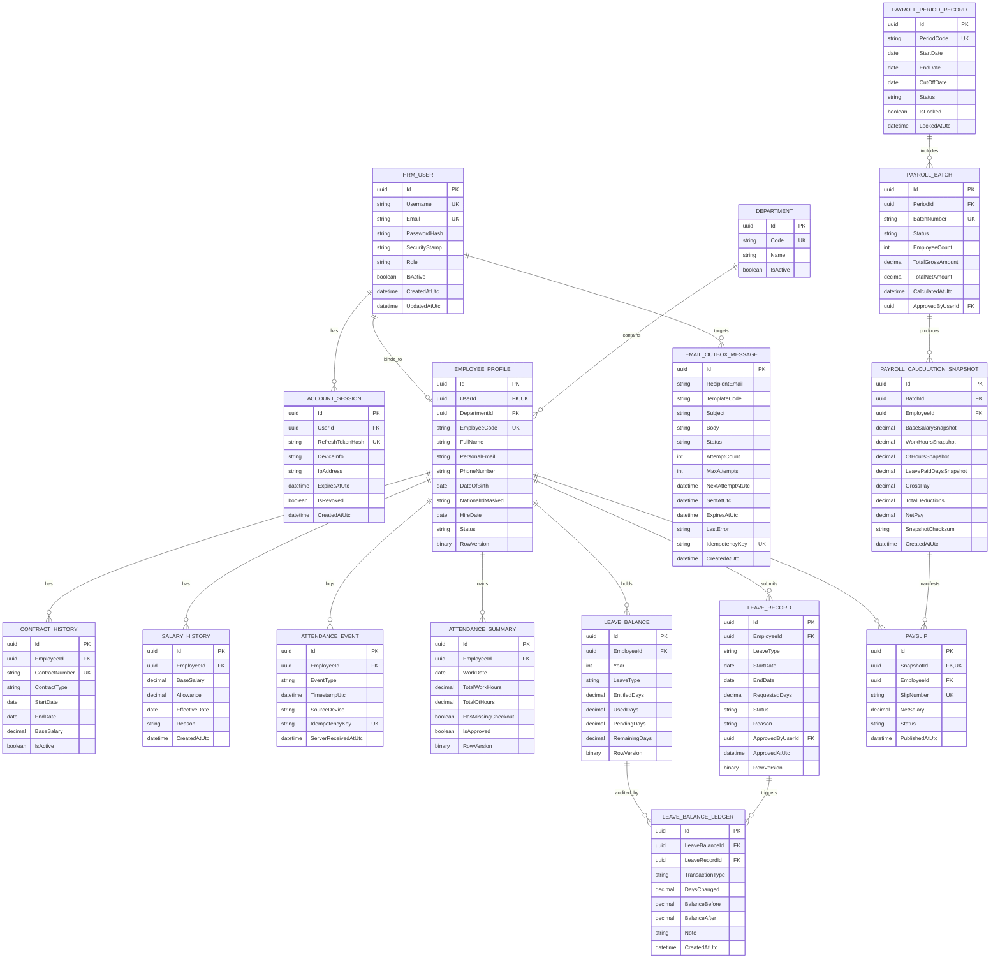

# Sơ đồ Quan hệ Thực thể Cốt lõi (ERD - Core Entities)

Tài liệu này trình bày cấu trúc dữ liệu quan hệ (Entity-Relationship Diagram) của hệ thống HRM trên cơ sở dữ liệu **Microsoft SQL Server 2022**. Mô hình dữ liệu được thiết kế theo chuẩn dạng chuẩn 3 (3NF) cho các quan hệ giao dịch và mô hình **Snapshot bất biến (Immutable Snapshot)** cho phân hệ tính lương và số dư ngày phép nhằm đảm bảo tính toàn vẹn và khả năng đối soát tài chính tuyệt đối.

---

## 1. Sơ đồ Quan hệ Thực thể Tổng thể (ERD Mermaid)



---

## 2. Phân tích Ràng buộc Toàn vẹn & An ninh Dữ liệu

### 2.1. Phân hệ Định danh & Quản lý Phiên (Identity & Session)
1. **Kiểm tra tức thời SecurityStamp**:
   - Trường `SecurityStamp` là một chuỗi GUID ngẫu nhiên được cập nhật mỗi khi người dùng đổi mật khẩu, bị khóa tài khoản hoặc HR cập nhật quyền.
   - Mọi request từ Client đi qua Middleware sẽ đối chiếu `SecurityStamp` trong token/session với cơ sở dữ liệu. Nếu sai lệch, hệ thống lập tức từ chối với mã **401 Unauthorized** (SLA thu hồi: $\le 0.05$ giây).
2. **Khóa tài khoản tự động (Account Lockout)**:
   - Hệ thống theo dõi số lần đăng nhập thất bại. Vượt quá 5 lần sai mật khẩu liên tiếp sẽ tự động chuyển `IsActive = false` và ghi nhận nhật ký an ninh.

### 2.2. Phân hệ Chấm công & Bảo đảm Idempotency (Attendance)
1. **Ràng buộc duy nhất trên `IdempotencyKey`**:
   - `IdempotencyKey` được sinh bởi thiết bị khách (Client UUID kết hợp hành động và mốc giờ).
   - Khi mạng bị chập chờn hoặc timeout sau khi cơ sở dữ liệu đã commit, yêu cầu retry từ Client sẽ chạm chỉ mục duy nhất:
     ```sql
     CREATE UNIQUE INDEX IX_AttendanceEvents_IdempotencyKey ON AttendanceEvents(IdempotencyKey);
     ```
   - Hệ thống bắt ngoại lệ trùng khóa và trả về kết quả thành công của bản ghi đã lưu mà không ghi nhận thêm sự kiện thứ hai.

### 2.3. Phân hệ Nghỉ phép & Chống Âm Quỹ (Leave Management)
1. **Ràng buộc kiểm tra số dư không âm (Check Constraint)**:
   - Cơ sở dữ liệu bảo đảm bất biến:
     ```sql
     ALTER TABLE LeaveBalances ADD CONSTRAINT CK_LeaveBalances_RemainingDays CHECK (RemainingDays >= 0);
     ```
2. **Khóa bi quan kết hợp lạc quan (Pessimistic & Optimistic Concurrency)**:
   - Khi phê duyệt đơn, Application layer thực thi truy vấn nạp `LeaveBalance` với gợi ý khóa `WITH (UPDLOCK, ROWLOCK)`.
   - Cột `RowVersion` kiểu `rowversion/timestamp` ngăn chặn Lost Update trong kịch bản nhiều quản lý cùng duyệt đồng thời trên các giao diện khác nhau.
3. **Sổ cái biến động số dư (Append-Only Ledger)**:
   - Bảng `LeaveBalanceLedger` ghi lại vết biến động: số ngày thay đổi, số dư trước và sau giao dịch, mã đơn phép liên quan và thời điểm ghi nhận. Bảng này mang tính chất chỉ ghi thêm (Append-Only), nghiêm cấm sửa hoặc xóa.

### 2.4. Phân hệ Lương & Snapshot Bất biến (Payroll Snapshot)
1. **Cơ chế Snapshot cách ly kỳ lương**:
   - Khi bấm "Tính lương nháp", toàn bộ các thông số: Mức lương cơ bản tại ngày chốt (`CutOffDate`), số giờ công thực tế, số giờ làm thêm (OT) và số ngày nghỉ hưởng lương được trích xuất và đóng băng vào bảng `PayrollCalculationSnapshot`.
   - Mọi thay đổi trong `SalaryHistory` hoặc bảng công của tháng sau hoàn toàn không ảnh hưởng đến số tiền đã lưu trong `PayrollCalculationSnapshot`.
2. **Khóa bất biến kỳ lương (`IsLocked = true`)**:
   - Khi kỳ lương được Giám đốc phê duyệt và công bố, cờ `IsLocked` được bật sang `true`.
   - Domain Model và Trigger cơ sở dữ liệu cấm mọi hành vi cập nhật hoặc xóa dữ liệu đối với kỳ đã khóa. Muốn điều chỉnh sai sót bắt buộc phải tạo bút toán truy thu/truy lĩnh ở kỳ lương tiếp theo (Retroactive Adjustment).

### 2.5. Phân hệ Transactional Outbox (Email Outbox)
1. **Giao dịch đồng thời nguyên tử (Atomic Enqueue)**:
   - Bản ghi `EmailOutboxMessage` được ghi trong cùng giao dịch cơ sở dữ liệu (`IDbContextTransaction`) với nghiệp vụ chính (tạo tài khoản, duyệt phép).
   - Nếu giao dịch nghiệp vụ rollback, thư thông báo sẽ không bao giờ được ghi vào outbox.
2. **Mặt nạ bảo mật (Token Redaction)**:
   - Các trường nhạy cảm trong `Body` (như token reset mật khẩu) chỉ lưu tạm thời với hạn dùng ngắn (15 phút). Mọi log hệ thống đều được lọc qua `EmailLogMasker` để thay thế token bằng ký tự ẩn danh `***REDACTED***`.

---

## 3. Liên kết Tài liệu Liên quan

- [Sơ đồ Kiến trúc Tổng thể](file:///d:/dotnet%20project/docs/diagrams/architecture-overview.md)
- [Sequence Diagram Duyệt Phép](file:///d:/dotnet%20project/docs/diagrams/sequence-leave-approval.md)
- [Sequence Diagram Tính Lương Snapshot](file:///d:/dotnet%20project/docs/diagrams/sequence-payroll-calculation.md)
- [Báo cáo Đối soát Di chuyển Dữ liệu T23](file:///d:/dotnet%20project/docs/verification/T23-rehearsal-evidence.md)
