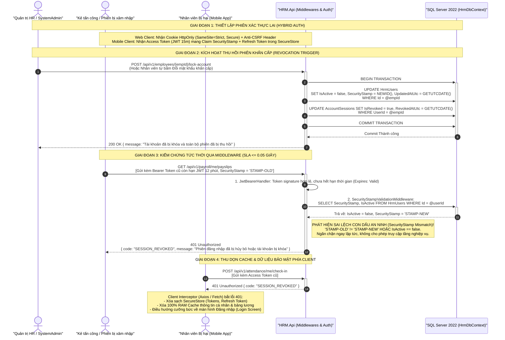

# Biểu đồ Trình tự Xác thực Lai và Thu hồi Phiên Tức thời (Sequence Diagram - Hybrid Auth & Session Revocation)

Tài liệu này mô tả chi tiết mô hình **Xác thực Lai (Hybrid Authentication Architecture)** và cơ chế **Thu hồi Phiên Đăng nhập Tức thời (Instant Session Revocation)** thông qua `SecurityStamp` trong hệ thống HRM.

---

## 1. Biểu đồ Trình tự Xử lý (Mermaid Sequence Diagram)

---

## 2. So sánh Chiến lược Xác thực Web vs. Mobile

| Tiêu chí | Web Portal (Admin / HR / Quản lý) | Mobile App (Nhân viên) |
|---|---|---|
| **Cơ chế chính** | Cookie `HttpOnly`, `SameSite=Strict`, `Secure` | Bearer Token (JWT 15 phút) mang Claim `SecurityStamp` |
| **Phòng chống XSS** | JavaScript hoàn toàn không thể đọc Cookie qua `document.cookie` | Token được lưu trong `SecureStore` (Android KeyStore / iOS Keychain) |
| **Phòng chống CSRF** | Bắt buộc đính kèm header `X-XSRF-TOKEN` cho mọi mutation (`POST`, `PUT`, `DELETE`) | Không áp dụng cơ chế tự gửi Cookie, miễn nhiễm tự nhiên với CSRF |
| **SLA Thu hồi Phiên** | $\le 0.05$ giây (Kiểm tra cơ sở dữ liệu trên mỗi request mutation) | $\le 0.05$ giây (Middleware kiểm tra đối chiếu `SecurityStamp`) |
| **Hành vi khi Logout** | Xóa Cookie trên trình duyệt và đánh dấu `IsRevoked` trên CSDL | Xóa Keychain / SecureStore và xóa toàn bộ state trong bộ nhớ RAM |

---

## 3. Liên kết Tài liệu Liên quan

- [Sơ đồ Kiến trúc Tổng thể](file:///d:/dotnet%20project/docs/diagrams/architecture-overview.md)
- [Báo cáo Kiểm thử T24 - Kiểm chứng Thu hồi Phiên](file:///d:/dotnet%20project/docs/verification/T24-e2e-security-report.md)
- [Kịch bản Demo Bảo vệ](file:///d:/dotnet%20project/docs/demo/demo-scenarios.md)
