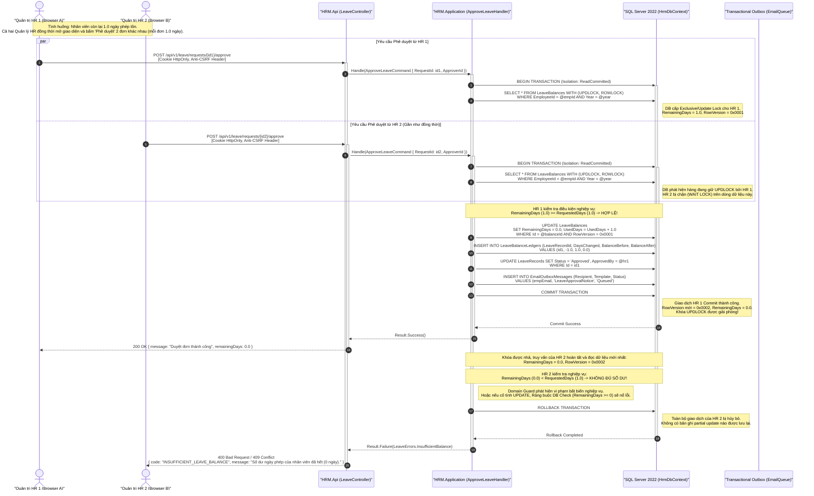

# Biểu đồ Trình tự Duyệt Đơn Nghỉ phép Đồng thời (Sequence Diagram - Concurrent Leave Approval)

Tài liệu này mô tả chi tiết quy trình xử lý giao dịch khi **hai Quản lý HR cùng thao tác duyệt đơn nghỉ phép đồng thời** trên hệ thống HRM, chứng minh cơ chế bảo vệ quỹ phép không bị âm và bảo toàn tính toàn vẹn giao dịch bằng cách kết hợp:
1. **Khóa bi quan tại mức hàng cơ sở dữ liệu (`UPDLOCK, ROWLOCK`)**.
2. **Khóa lạc quan thông qua thẻ kiểm soát phiên bản (`RowVersion`)**.
3. **Ràng buộc toàn vẹn cứng tại cơ sở dữ liệu (`CHECK (RemainingDays >= 0)`)**.
4. **Sổ cái biến động lịch sử (Append-Only `LeaveBalanceLedger`)**.

---

## 1. Biểu đồ Trình tự Xử lý (Mermaid Sequence Diagram)

---

## 2. Các Tầng Phòng Ngự Chống Lỗi Đồng Thời (Concurrency Safeguards)

Hệ thống triển khai mô hình phòng vệ 4 lớp đối với phân hệ nghỉ phép:

| Lớp phòng ngự | Cơ chế kỹ thuật | Trách nhiệm |
|---|---|---|
| **1. Application Domain Guard** | Kiểm tra số dư trước khi ghi (`balance.RemainingDays >= request.Days`) | Ngăn chặn các yêu cầu không hợp lệ ngay tại tầng ứng dụng |
| **2. Concurrency Lock** | `WITH (UPDLOCK, ROWLOCK)` trong EF Core / SQL Server | Tuần tự hóa các giao dịch ghi cạnh tranh trên cùng một nhân viên |
| **3. Optimistic Token** | Cột `RowVersion` kiểu `timestamp/rowversion` | Bắt lỗi tranh chấp phiên bản (Lost Update) giữa 2 trình duyệt |
| **4. Database Constraint** | `CHECK (RemainingDays >= 0)` | Lưới an toàn cuối cùng cấp CSDL, bảo đảm quỹ phép tuyệt đối không bị âm |

---

## 3. Liên kết Tài liệu Liên quan

- [Sơ đồ ERD](file:///d:/dotnet%20project/docs/diagrams/erd-core-entities.md)
- [Báo cáo Kiểm thử T24 - Kịch bản Hai trình duyệt duyệt đồng thời](file:///d:/dotnet%20project/docs/verification/T24-e2e-security-report.md)
- [Kịch bản Demo Bảo vệ](file:///d:/dotnet%20project/docs/demo/demo-scenarios.md)
