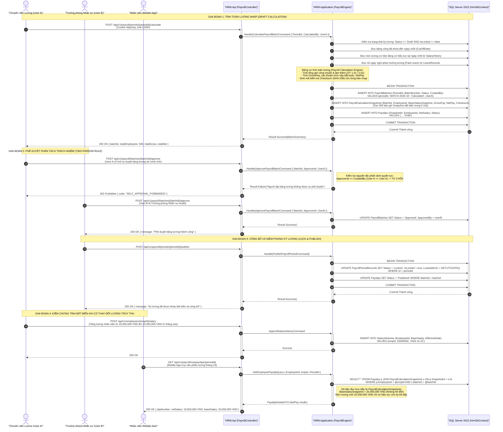

# Biểu đồ Trình tự Tính Lương Snapshot và Đóng Băng Kỳ Lương (Sequence Diagram - Payroll Calculation & Immutability)

Tài liệu này mô tả chi tiết chu trình tính toán lương, kiểm soát phân tách trách nhiệm (Segregation of Duties), tạo bản chụp số liệu bất biến (**Immutable Snapshot**) và niêm phong kỳ lương (**Locked Period**), đảm bảo nguyên tắc: **Bất kỳ thay đổi nào về mức lương cơ bản hoặc chấm công trong tương lai đều không làm thay đổi phiếu lương của kỳ đã đóng**.

---

## 1. Biểu đồ Trình tự Xử lý (Mermaid Sequence Diagram)



---

## 2. Các Nguyên tắc Thiết kế Bất biến (Immutability Invariants)

1. **Snapshot-First Architecture**: Bảng `PayrollCalculationSnapshot` ghi lại trạng thái tĩnh của toàn bộ các yếu tố đầu vào (công chuẩn, giờ OT, ngày nghỉ hưởng lương, mức lương danh nghĩa) tại thời điểm chốt sổ.
2. **Two-Person Rule (Phân tách quyền)**: Người khởi tạo lệnh tính lương (`CalculatedBy`) bị cấm duyệt bảng lương (`ApprovedBy`). Điều kiện được kiểm soát bằng Domain Invariant:
   ```csharp
   if (batch.CreatedByUserId == currentUserId)
       throw new BusinessRuleValidationException("Người tính lương không được tự phê duyệt bảng lương.");
   ```
3. **Database Write Protection**: Khi `IsLocked == true`, Trigger trên bảng `PayrollPeriodRecords` và `PayrollCalculationSnapshots` sẽ hủy bỏ (RAISERROR) bất kỳ câu lệnh `UPDATE` hoặc `DELETE` nào tác động lên kỳ lương đã khóa.
4. **Không tính đè lương cũ (Append-Only Salary History)**: Biến động lương được ghi nối tiếp vào `SalaryHistories`. Tính lương của bất kỳ kỳ nào luôn lấy theo mốc thời gian:
   ```sql
   SELECT TOP 1 BaseSalary FROM SalaryHistories 
   WHERE EmployeeId = @empId AND EffectiveDate <= @cutOffDate 
   ORDER BY EffectiveDate DESC, CreatedAtUtc DESC;
   ```

---

## 3. Liên kết Tài liệu Liên quan

- [Sơ đồ ERD Thực thể Cốt lõi](file:///d:/dotnet%20project/docs/diagrams/erd-core-entities.md)
- [Báo cáo Thử nghiệm Tải T26 (500 nhân sự trong 0.10 giây)](file:///d:/dotnet%20project/docs/benchmarks/t26-performance-report.md)
- [Kịch bản Demo Bảo vệ](file:///d:/dotnet%20project/docs/demo/demo-scenarios.md)
