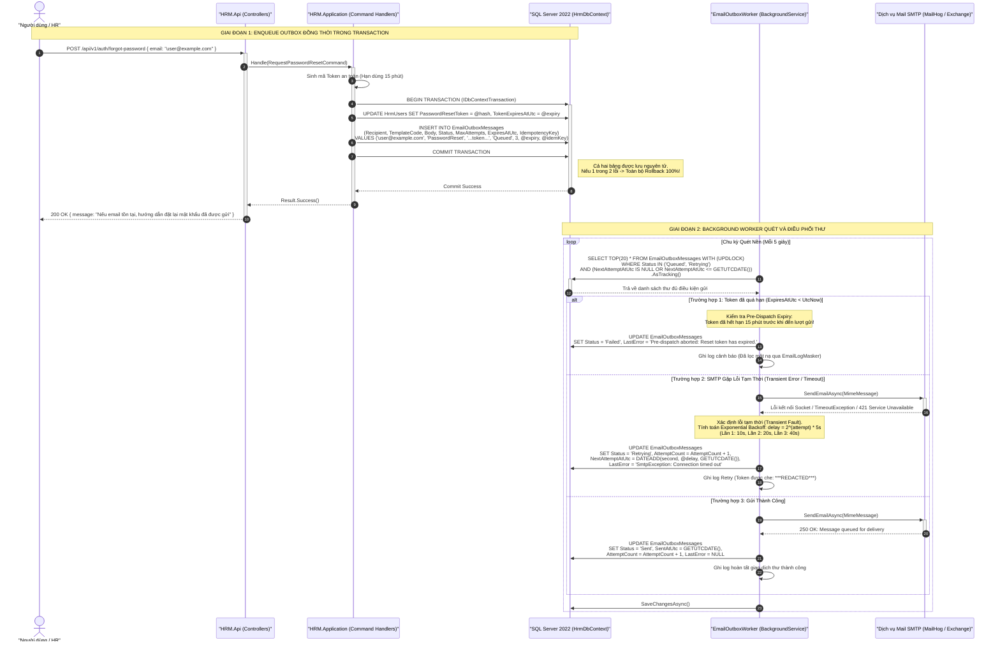

# Biểu đồ Trình tự Transactional Outbox và Xử lý Gửi Email Nền (Sequence Diagram - Transactional Outbox & Email Worker)

Tài liệu này mô tả chi tiết mô hình thiết kế **Transactional Outbox Pattern** và tiến trình xử lý nền **EmailOutboxWorker** trong hệ thống HRM. Kiến trúc này giải quyết triệt để vấn đề:
1. **Tính nguyên tử kép (Dual-Write Problem)**: Đảm bảo dữ liệu nghiệp vụ và thông báo gửi email cùng được lưu thành công trong một giao dịch cơ sở dữ liệu (`IDbContextTransaction`), không bao giờ xảy ra tình trạng "đã gửi email nhưng dữ liệu nghiệp vụ rollback" hoặc "đã lưu nghiệp vụ nhưng rớt email".
2. **Cơ chế thử lại lũy thừa (Exponential Backoff Retry)**: Tự động phục hồi khi máy chủ SMTP bị nghẽn mạng hoặc khởi động lại.
3. **Chặn gửi token hết hạn (Pre-dispatch Expiration Abort)**: Không gửi email chứa token đổi mật khẩu đã quá hạn.
4. **Mặt nạ bảo mật nhật ký (Safe Log Masking)**: Ngăn chặn tuyệt đối việc rò rỉ token hoặc thông tin bí mật ra tệp nhật ký hệ thống.

---

## 1. Biểu đồ Trình tự Xử lý (Mermaid Sequence Diagram)



---

## 2. Các Đặc tính Kỹ thuật Trọng yếu (Design Highlights)

1. **Explicit Tracking (`.AsTracking()`)**:
   - `HrmDbContext` được cấu hình mặc định toàn cục `QueryTrackingBehavior.NoTracking` để tăng tối đa thông lượng đọc.
   - Do đó, `EmailOutboxWorker` bắt buộc phải gọi `.AsTracking()` một cách tường minh khi truy vấn các bản ghi `EmailOutboxMessages`, bảo đảm `SaveChangesAsync()` kích hoạt câu lệnh `UPDATE` trạng thái xuống SQL Server.
2. **Cơ chế Idempotency chống gửi trùng**:
   - Trường `IdempotencyKey` ngăn ngừa việc đưa hai thông báo cùng loại cho cùng một sự kiện vào cơ sở dữ liệu.
3. **Pre-dispatch Expiration Check**:
   - Nếu hàng đợi bị nghẽn (ví dụ mất điện hoặc đứt cáp Internet 30 phút), khi worker chạy lại, các email chứa link reset mật khẩu (hạn dùng 15 phút) sẽ bị hủy ngay trước khi gửi đi, ngăn ngừa gửi email chứa liên kết vô hiệu cho người dùng.
4. **Bảo mật Nhật ký Hệ thống (Log Sanitization)**:
   - Sử dụng bộ lọc `EmailLogMasker` với các biểu thức chính quy (Regex) tự động tìm và thay thế các chuỗi bí mật:
     ```csharp
     sanitized = Regex.Replace(rawContent, @"(token=|code=)[a-zA-Z0-9_\-]+", "$1***REDACTED***");
     ```

---

## 3. Liên kết Tài liệu Liên quan

- [Sơ đồ Kiến trúc Tổng thể](file:///d:/dotnet%20project/docs/diagrams/architecture-overview.md)
- [Hướng dẫn Vận hành Email](file:///d:/dotnet%20project/docs/operations/email.md)
- [Báo cáo Kiểm thử T22 - 8/8 Tests Pass trên Fake SMTP](file:///d:/dotnet%20project/docs/operations/email.md#4-kiem-thu-kiem-chung-fake-smtp)
